<picture><source media="(prefers-color-scheme: dark)" srcset="assets/hero-dark.svg"></picture>

<picture><source media="(prefers-color-scheme: dark)" srcset="assets/about-dark.svg"></picture>

<a href="https://github.com/nenyuxdev/fdlclient"><picture><source media="(prefers-color-scheme: dark)" srcset="assets/project-fdlclient-dark.svg"></picture></a>&nbsp;<a href="https://github.com/nenyuxdev/sideloadclient"><picture><source media="(prefers-color-scheme: dark)" srcset="assets/project-sideloadclient-dark.svg"></picture></a>

<a href="https://metawka.github.io/expressive-profile/?from=nenyuxdev"><picture><source media="(prefers-color-scheme: dark)" srcset="assets/credit-dark.svg"></picture></a>

